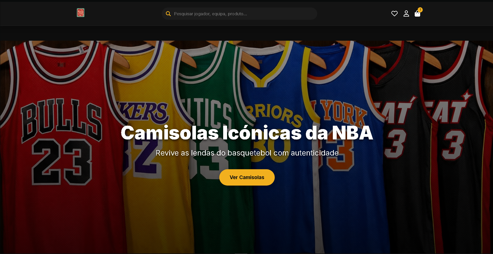
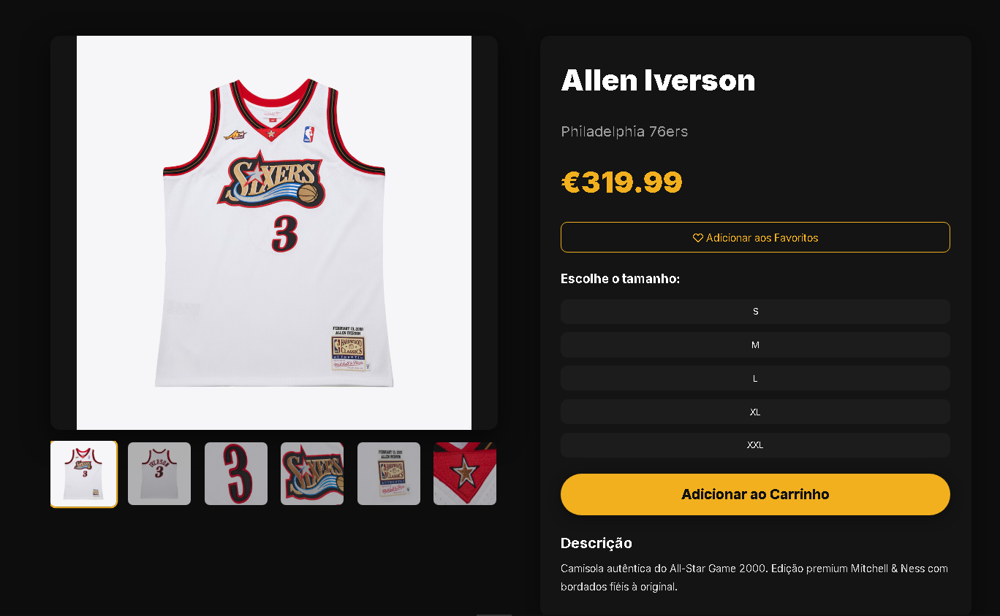
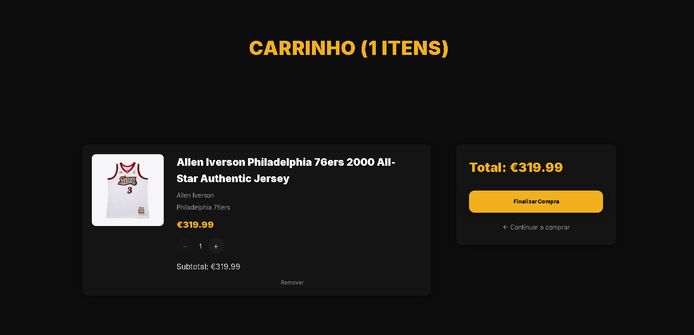

# HOOP

[](https://react.dev/)
[](https://www.typescriptlang.org/)
[](https://vite.dev/)
[](https://reactrouter.com/)
[](LICENSE)

> Basketball, culture and e-commerce in one digital experience.

**Academic project:** HOOP is a fictional basketball store created for educational purposes. It does not represent a real shop, process real purchases or have a commercial relationship with the brands and products shown in the interface.

## Overview

HOOP simulates the experience of discovering and buying basketball products online. Users can browse a catalogue, view product details, manage favourites and a cart, explore an account area and complete a simulated checkout flow.

The project was built to practise React architecture, reusable components, typed data and shared state across pages. The first versions date to **December 2025**, with continued development and refinement through **2026**.

**[Open the live demo](https://hoop-16alves02.netlify.app)**

## Features

- **Homepage:** rotating hero slides, featured products, promotional content and responsive layout.
- **Product discovery:** search by name, player or team, with filters for type, gender, size, price, brand, colour, new arrivals and promotions.
- **Sorting and pagination:** sort by price, name or newest items, with filter state reflected in the URL.
- **Product details:** image gallery, descriptions, prices, available sizes, favourites, cart actions and a review area.
- **Favourites:** save products locally for later.
- **Shopping cart:** add and remove items, select sizes, change quantities, calculate totals and clear the cart.
- **Account area:** simulated login, registration and profile, with the session persisted locally.
- **Multi-step checkout:** login, delivery, payment and confirmation screens, with simulated card, MB WAY, Multibanco, PayPal, Apple Pay and Google Pay options.
- **Supporting pages:** About, Contact, FAQ, Buying Guide, Size Guide, Terms and Conditions, and Privacy Policy.

**Authentication and checkout are simulations only.** There is no real authentication provider, commerce backend or payment processor.

## Architecture

The source code is organised into reusable components, pages, shared contexts, product data, styles and routing.

```text
src/
├── components/
├── context/
│   ├── AuthContext
│   ├── CarrinhoContext
│   ├── FavoritosContext
│   └── ToastContext
├── data/
│   ├── produtos.json
│   └── produtos.ts
├── pages/
│   ├── Home
│   ├── Produtos
│   ├── Pesquisa
│   ├── ProdutoDetalhes
│   ├── Carrinho
│   ├── Favoritos
│   ├── Checkout
│   └── institutional pages
├── styles/
├── Layout.tsx
└── main.tsx
```

React Context shares the cart, favourites, authentication and toast-notification state across the application. The simulated session, cart and favourites are saved in browser `localStorage` between visits.

## Technology stack

| Technology | Purpose |
| --- | --- |
| React 19 | Component-based user interface |
| TypeScript 5 | Static typing for application code and product data |
| Vite 7 | Development server and production build |
| React Router DOM 7 | Client-side routing and nested pages |
| React Context API | Shared state for cart, favourites, authentication and notifications |
| React Icons | Interface icons |
| ESLint | Code quality and linting |

The project uses `useState` for local and provider state, `useEffect` to synchronise cart and favourites with `localStorage`, `useContext` to access shared contexts and `useNavigate` for programmatic navigation. Routing also uses `BrowserRouter`, `Routes`, `Route`, `Link` and `Outlet`.

## Run locally

You need Node.js and npm installed.

```bash
git clone https://github.com/16alves02/hoop.git
cd hoop
npm install
npm run dev
```

Vite prints the local development URL in the terminal.

### Other commands

```bash
npm run build
npm run preview
npm run lint
```

- `npm run build` creates a production build.
- `npm run preview` serves the production build locally.
- `npm run lint` runs ESLint.

## Screenshots

### Home



### Product



### Cart



## Visual identity

HOOP uses a premium basketball-store aesthetic with a near-black background, yellow accents, dark-grey cards, high-contrast typography and product imagery. Responsive styling is designed to keep the interface usable across screen sizes.

## Future improvements

- Add automated unit and component tests with Vitest and React Testing Library.
- Add end-to-end tests for search, filters, cart and checkout.
- Review accessibility, including keyboard navigation, focus states and screen-reader support.
- Extract repeated logic into typed custom hooks and strengthen form validation.
- Consider a real backend and secure authentication only if the project moves beyond its academic simulation.
- Test a payment-provider integration in a controlled environment before considering real transactions.
- Review image loading, code splitting and route-level lazy loading for performance.

## Project history

- **December 2025:** first HOOP Store versions committed.
- **January 2026:** major development phase, including routing, TypeScript fixes, project structure and store features.
- **2026:** continued work on product data, screenshots, documentation and presentation.

## Author

**Leonardo Alves** · [@16alves02](https://github.com/16alves02)

## License and copyright

Copyright (c) 2025-2026 Leonardo Alves (16alves02). All rights reserved.

This project is **not open source**. The source code is published for viewing and educational reference. It may not be copied, redistributed, modified for public or commercial use, sublicensed, sold, or presented as someone else's work without prior written permission.

See [LICENSE](./LICENSE) for the full terms.
