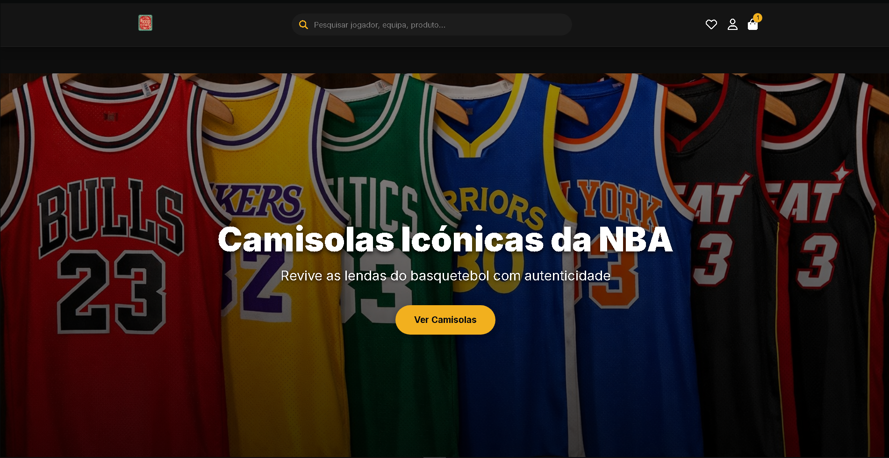
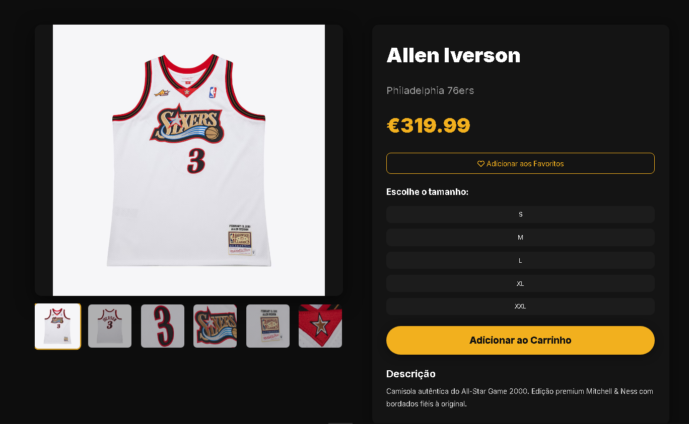
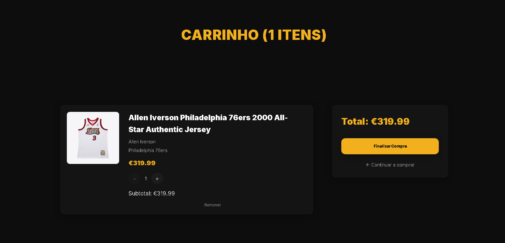

# 🏀 HOOP

[](https://react.dev/)
[](https://www.typescriptlang.org/)
[](https://vite.dev/)
[](https://reactrouter.com/)
[](https://developer.mozilla.org/en-US/docs/Web/CSS)
[](https://react-icons.github.io/react-icons/)
[](https://nodejs.org/)
[](https://eslint.org/)
[](LICENSE)

> **Basketball, culture and e-commerce in one digital experience.**

> ⚠️ **Academic project:** HOOP is a fictional e-commerce experience. It does not represent a real store, process real purchases or have a commercial relationship with the brands and products represented in the interface.

## 🚀 Project Description

**HOOP** is a basketball-focused e-commerce web application built to simulate the experience of discovering and purchasing basketball products. It combines a sports-oriented visual identity with a complete client-side shopping flow, from browsing the catalogue and viewing product details to favourites, cart, account screens and a simulated checkout.

The project is designed as a frontend learning experience, with a component-based React architecture, typed product data, reusable UI elements and shared application state. The first versions were developed in **December 2025**, followed by significant development and refinement during **2026**.

**[Open the live demo](https://hoop-16alves02.netlify.app)**

### Main features

- **Homepage:** rotating hero slides, featured products, promotional content and responsive layout.
- **Product discovery:** search by product name, player or team, plus filters for type, gender, size, price, brand, team, player, colour, new products and promotions.
- **Sorting and pagination:** sort by price, name or newest items. Filter state is reflected in the URL.
- **Product details:** product gallery, descriptions, prices, available sizes, favourites, cart actions and review interfaces.
- **Favourites:** save products locally and access them later.
- **Shopping cart:** add and remove items, select sizes, change quantities, calculate totals and clear the cart.
- **Account screens:** simulated login, registration, profile and local session persistence.
- **Multi-step checkout:** login, delivery, payment and success screens, with simulated card, MB WAY, Multibanco, PayPal, Apple Pay and Google Pay options.
- **Supporting pages:** About, Contact, FAQ, Buying Guide, Size Guide, Terms and Conditions, Privacy Policy and legal information.

Authentication and checkout are **simulations only**. The application does not use a real authentication provider, backend commerce system or payment processor.

## 🧱 Architecture

The source code is organised around pages, reusable components, global contexts, product data, styles and routing.

```text
src/
├── components/
├── context/
│   ├── AuthContext
│   ├── CarrinhoContext
│   ├── FavoritosContext
│   └── ToastContext
├── data/
│   ├── produtos.json
│   └── produtos.ts
├── pages/
│   ├── Home
│   ├── Produtos
│   ├── Pesquisa
│   ├── ProdutoDetalhes
│   ├── Carrinho
│   ├── Favoritos
│   ├── Checkout
│   └── Institutional pages
├── styles/
├── Layout.tsx
└── main.tsx
```

React Context is used to share authentication, cart, favourites and toast notification state. Browser `localStorage` persists the simulated user session, cart and favourites between visits.

## 🛠️ Tech Stack & Hooks

### Visual tech stack

The badges at the top identify the main technologies and tooling used by the project.

| Technology | Role |
| --- | --- |
| React 19 | Component-based user interface |
| TypeScript 5 | Static typing for application code and product data |
| Vite 7 | Development server and production build |
| React Router DOM 7 | Client-side routing and nested pages |
| React Context API | Shared state for cart, favourites, authentication and notifications |
| CSS3 | Layout, styling and responsive behaviour |
| React Icons | Interface icons |
| Node.js and npm | JavaScript runtime and dependency management |
| ESLint | Code quality and linting |

### React hooks identified in the source

- `useState`: local UI state and shared provider state.
- `useEffect`: synchronises cart and favourites with `localStorage`.
- `useContext`: reads shared application contexts.
- `useNavigate`: programmatic navigation through React Router.

The project also uses React Router components such as `BrowserRouter`, `Routes`, `Route`, `Link` and `Outlet`.

## 💻 How to Run

### Requirements

- Node.js
- npm

### 1. Clone the repository

```bash
git clone https://github.com/16alves02/hoop.git
cd hoop
```

### 2. Install dependencies

```bash
npm install
```

### 3. Start the development server

```bash
npm run dev
```

Vite prints the local URL in the terminal. Open that address in your browser.

### Other commands

```bash
npm run build
npm run preview
npm run lint
```

- `npm run build` checks TypeScript and creates the production build.
- `npm run preview` serves the production build locally.
- `npm run lint` runs ESLint.

## 📸 Screenshots

### Home



### Product



### Cart



## 🎨 Visual Identity

HOOP follows a premium basketball-store aesthetic built around a dark, near-black background, yellow accents, dark-grey cards, high-contrast typography and basketball product imagery. Responsive styling keeps the experience usable across different screen sizes.

## 🔮 Future Improvements

- Add automated unit and component tests with Vitest and React Testing Library.
- Add end-to-end tests for search, filters, cart and checkout flows.
- Improve accessibility with keyboard-flow checks, consistent focus states and screen-reader testing.
- Extract repeated business logic into typed custom hooks and strengthen form validation.
- Add a real backend and secure authentication only if the project moves beyond its academic simulation.
- Connect checkout to a payment provider in a controlled test environment before considering real transactions.
- Review image loading, code splitting and route-level lazy loading to improve browser performance.

## 🗓️ Project History

- **December 2025:** first HOOP Store versions committed.
- **January 2026:** major development phase, including routing, TypeScript fixes, project structure and store functionality.
- **2026:** continued work on product data, screenshots, documentation and presentation.

## 👤 Author

**Leonardo Alves - [@16alves02](https://github.com/16alves02)**

HOOP is part of the **16alves02** project portfolio.

## 📜 License & Copyright

**Copyright (c) 2025-2026 Leonardo Alves (16alves02). All rights reserved.**

This project is **not open source**. The source code is published for viewing and educational reference, but it may not be copied, redistributed, modified for public or commercial use, sublicensed, sold, or presented as someone else's work without prior written permission.

See the [LICENSE](./LICENSE) file for the full terms.
